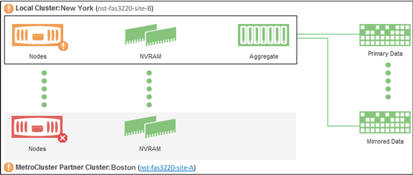

= Verifique a integridade dos clusters em uma configuração MetroCluster no Active IQ Unified Manager
:allow-uri-read: 
:icons: font
:imagesdir: ../media/

[role="lead"]
Você pode usar o Active IQ Unified Manager (Unified Manager) para verificar a integridade operacional dos clusters e de seus componentes nas configurações MetroCluster over FC e MetroCluster over IP. Se os clusters estiveram envolvidos em um evento de desempenho detectado pelo Unified Manager, o status de integridade pode ajudar você a determinar se um problema de hardware ou software contribuiu para o evento.

.Antes de começar
* Você precisa ter a função de Operador, Administrador de Aplicativos ou administrador de storage.
* Você deve ter analisado um evento de desempenho para uma configuração MetroCluster e obtido o nome do cluster envolvido.
* Ambos os clusters na configuração do MetroCluster por FC e IP devem ser monitorados pela mesma instância do Unified Manager.

[[determine-cluster-health-in-metrocluster-over-fc-configuration]]
== Determine a integridade do cluster na configuração do MetroCluster sobre FC

Siga estes passos para determinar a integridade do cluster em uma configuração do MetroCluster over FC.

.Passos
. No painel de navegação esquerdo, clique em *Gerenciamento de Eventos* para exibir a lista de eventos.
. No painel de filtros, selecione todos os filtros do MetroCluster na categoria *Tipo de Origem*. Você verá todos os eventos gerados em seu ambiente para todas as configurações do MetroCluster.
. Ao lado de um evento do MetroCluster, clique no nome do cluster.
+
[NOTE]
====
Caso nenhum evento do MetroCluster seja exibido, você pode usar a barra de pesquisa para procurar o nome do cluster envolvido no evento relacionado à sua configuração MetroCluster over FC.

====
+
A visualização Saúde: todos os Clusters é exibida com informações detalhadas sobre o evento.

. Selecione a guia *MetroCluster Conectividade* para exibir a integridade da conexão entre o cluster selecionado e seu cluster parceiro.
+
image::../media/opm_um_mcc_connectivity_tab_png.gif[A guia de conectividade do MetroCluster no Unified Manager]

+
Neste exemplo, você vê os nomes e os componentes do cluster local e do cluster parceiro. Um ícone amarelo ou vermelho indica um evento de integridade para o componente destacado. O ícone Connectivity representa a ligação entre os clusters. Você pode apontar o cursor do mouse para um ícone para exibir informações do evento ou clicar no ícone para exibir os eventos. Um problema de integridade em qualquer um dos clusters pode ter contribuído para o evento de desempenho.

+
O Unified Manager monitora o componente NVRAM do link entre os clusters. Se o ícone de FC Switches no cluster local ou parceiro, ou o ícone de Connectivity, estiver vermelho, um problema de integridade do link pode ter causado o evento de desempenho.

. Selecione a guia *Replicação do MetroCluster*.
+

+
Neste exemplo, se o ícone da NVRAM no cluster local ou parceiro estiver amarelo ou vermelho, um problema de integridade com a NVRAM pode ter causado o evento de desempenho. Se não houver ícones vermelhos ou amarelos na página, um problema de desempenho no cluster parceiro pode ter causado o evento de desempenho.

[[determine-cluster-health-in-metrocluster-over-ip-configuration]]
== Determine a integridade do cluster na configuração do MetroCluster over IP

Siga estes passos para determinar a integridade do cluster em uma configuração do MetroCluster over IP.

.Passos
. No painel de navegação esquerdo, clique em *Gerenciamento de Eventos* para exibir a lista de eventos.
. No painel de filtros, na categoria *Tipo de Origem*, selecione o  `MetroCluster Relationship` filtro. Você vê todos os eventos gerados em seu ambiente para todas as configurações do MetroCluster.
+
[NOTE]
====
Caso você não consiga visualizar os eventos relatados do MetroCluster, você pode usar a barra de pesquisa para buscar pelo nome do cluster envolvido no evento relacionado à sua configuração de MetroCluster over IP.

====
. Ao lado do evento relevante do MetroCluster, clique no nome do cluster. A página Clusters é exibida com os detalhes desse cluster. Para obter informações sobre como determinar problemas de integridade, consulte link:../storage-mgmt/task_monitor_metrocluster_configurations.html["Monitorar problemas de conectividade na configuração do MetroCluster sobre IP"].

