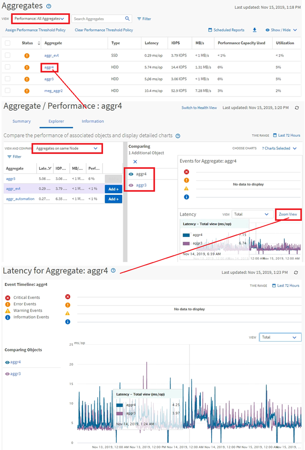

= Monitore a navegação de desempenho do cluster no Active IQ Unified Manager
:allow-uri-read: 
:icons: font
:imagesdir: ../media/

[role="lead"]
Você pode monitorar o desempenho de todos os clusters gerenciados pelo Unified Manager. O monitoramento de seus clusters fornece uma visão geral do desempenho do cluster e dos objetos e inclui o monitoramento de eventos de desempenho. Você pode visualizar o desempenho e os eventos em alto nível ou investigar mais detalhadamente qualquer detalhe do desempenho do cluster e dos objetos e dos eventos de desempenho.

Este é um exemplo de muitos caminhos de navegação possíveis para o desempenho de um cluster:

. No painel de navegação esquerdo, clique em *Armazenamento* > *Agregados*.
. Para visualizar informações sobre o desempenho nesses agregados, selecione a visualização Desempenho: todos os agregados.
. Identifique o agregado que você deseja investigar e clique no nome desse agregado para navegar até a página Aggregate / Performance Explorer.
. Opcionalmente, selecione outros objetos para comparar com este agregado no menu Exibir e Comparar e, em seguida, adicione um dos objetos ao painel de comparação.
+
As estatísticas de ambos os objetos aparecerão nos gráficos do contador para comparação.

. No painel Comparing, à direita na página Explorer, clique em *Zoom View* em um dos gráficos de contador para ver detalhes sobre o histórico de desempenho desse agregado.

