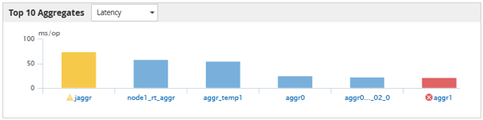

= Veja a página dos Melhores Desempenhos em Active IQ Unified Manager
:allow-uri-read: 
:icons: font
:imagesdir: ../media/

[role="lead"]
A página "Melhores Desempenhos" exibe os objetos de storage que têm o maior desempenho ou o menor desempenho, com base no contador de desempenho que você selecionar. Por exemplo, na categoria "VMs de storage", você pode exibir as SVMs que têm o maior número de IOPS, a maior latência ou o menor MB/s. Esta página também mostra se algum dos objetos com melhor desempenho tem eventos de desempenho ativos (novos ou reconhecidos).

A página "Top Performers" exibe no máximo 10 de cada objeto. Observe que o objeto "Volume" inclui tanto volumes FlexVol quanto volumes FlexGroup.

* *Período de tempo*
+
Você pode selecionar um intervalo de tempo para visualizar os itens com melhor desempenho; o intervalo de tempo selecionado se aplica a todos os objetos de storage. Intervalos de tempo disponíveis:

+
** Última hora
** Últimas 24 horas
** Últimas 72 horas (padrão)
** Últimos 7 dias

* *Métrica*
+
Clique no menu *Métrica* para selecionar um contador diferente. As opções de contador são exclusivas de cada tipo de objeto. Por exemplo, os contadores disponíveis para o objeto *Volumes* são *Latência*, *IOPS* e *MB/s*. Alterar o contador recarrega os dados do painel com os objetos de melhor desempenho com base no contador selecionado.

+
Contadores disponíveis:

+
** Latência
** IOPS
** MB/s
** Capacidade de desempenho utilizada (para nós e agregados)
** Utilização (para nós e agregados)

* *Ordenar*
+
Clique no menu *Classificar* para selecionar uma classificação crescente ou decrescente para o objeto e o contador selecionados. As opções são *Do maior para o menor* e *Do menor para o maior*. Essas opções permitem visualizar os objetos com o maior desempenho ou o menor desempenho.

* *Barra de contador*
+
A barra do contador no gráfico mostra as estatísticas de desempenho de cada objeto, representadas como uma barra para esse item. Os gráficos de barras são codificados por cores. Se o contador não estiver ultrapassando um limite de desempenho, a barra do contador será exibida em azul. Se uma violação de limite estiver ativa (um evento novo ou reconhecido), a barra será exibida na cor do evento: eventos de aviso são exibidos em amarelo (image:../media/treemapstatus_warning_png.gif["Ícone do TreeMap: status de aviso"]) e eventos críticos são exibidos em vermelho (image:../media/treemapred_png.gif["Ícone para TreeMap: cor vermelha"]). As violações de limite também são indicadas por ícones indicadores de gravidade do evento para eventos de aviso e críticos.

+

+
Em cada gráfico, o eixo X exibe os itens com melhor desempenho para o tipo de objeto selecionado. O eixo Y exibe as unidades aplicáveis ao contador selecionado. Clicar no link do nome do objeto abaixo de cada elemento do gráfico de barras vertical leva você à página inicial de desempenho do objeto selecionado.

* *Indicador de evento de severidade*
+
O ícone indicador de *Evento Grave* é exibido à esquerda do nome de um objeto para eventos críticos ativos (image:../media/sev_critical_um60.png["Ícone para gravidade do evento: crítico"]) ou de aviso (image:../media/sev_warning_um60.png["Ícone de aviso para gravidade do evento"]) nos gráficos de melhor desempenho. Clique no ícone indicador de *Evento Grave* para visualizar:

+
** *Um evento*
+
Leva você à página de detalhes desse evento.

** *Dois ou mais eventos*
+
Navega até a página de inventário de eventos, filtrada para exibir todos os eventos do objeto selecionado.

* *Botão Exportar*
+
Cria um `.csv` arquivo que contém os dados exibidos na barra de contagem. Você pode optar por criar o arquivo para o cluster específico que está visualizando ou para todos os clusters do data center.

