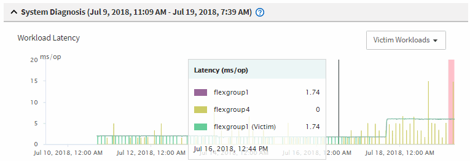

= Analise um evento de desempenho do MetroCluster em um cluster no Active IQ Unified Manager
:allow-uri-read: 
:icons: font
:imagesdir: ../media/

[role="lead"]
Você pode usar o Unified Manager para analisar o cluster em uma configuração do MetroCluster na qual foi detectado um evento de desempenho. Você pode identificar o nome do cluster, o horário de detecção do evento e as cargas de trabalho _agressora_ e _vítima_ envolvidas.

.Antes de começar
* Você precisa ter a função de Operador, Administrador de Aplicativos ou administrador de storage.
* Deve haver eventos de desempenho novos, reconhecidos ou obsoletos para uma configuração MetroCluster.
* Ambos os clusters na configuração do MetroCluster devem ser monitorados pela mesma instância do Unified Manager.

.Passos
. Exiba a página *Detalhes do evento* para visualizar informações sobre o evento.
. Analise a descrição do evento para ver os nomes das cargas de trabalho envolvidas e o número de cargas de trabalho envolvidas.
+
Neste exemplo, o ícone de Recursos do MetroCluster está vermelho, indicando que os recursos do MetroCluster estão em disputa. Você posiciona o cursor sobre o ícone para exibir uma descrição do ícone.

+
image::../media/opm_mcc_incident_summary_png.gif[Resumo do evento de desempenho para a configuração do MetroCluster]

. Anote o nome do cluster e o horário de detecção do evento, que você poderá usar para analisar eventos de desempenho no cluster parceiro.
. Nos gráficos, analise as cargas de trabalho da _vítima_ para confirmar se seus tempos de resposta são superiores ao limite de desempenho.
+
Neste exemplo, a carga de trabalho vítima é exibida no texto ao passar o cursor. Os gráficos de latência mostram, em alto nível, um padrão de latência consistente para as cargas de trabalho vítimas envolvidas. Embora a latência anormal das cargas de trabalho vítimas tenha acionado o evento, um padrão de latência consistente pode indicar que as cargas de trabalho estão operando dentro da faixa esperada, mas que um pico de E/S aumentou a latência e acionou o evento.

+

+
Se você instalou recentemente um aplicativo em um cliente que acessa essas cargas de trabalho de volume e esse aplicativo envia uma grande quantidade de E/S para elas, você pode prever que a latência delas aumente. Se a latência das cargas de trabalho voltar ao intervalo esperado, o estado do evento mudar para obsoleto e permanecer nesse estado por mais de 30 minutos, você provavelmente poderá ignorar o evento. Se o evento continuar e permanecer no novo estado, você poderá investigá-lo mais a fundo para determinar se outros problemas causaram o evento.

. No gráfico Taxa de transferência da carga de trabalho, selecione *Cargas de trabalho agressoras* para exibir as cargas de trabalho agressoras.
+
A presença de cargas de trabalho excessivas indica que o evento pode ter sido causado por uma ou mais cargas de trabalho no cluster local que sobrecarregaram os recursos do MetroCluster. As cargas de trabalho excessivas apresentam um desvio elevado na taxa de transferência de gravação (MB/s).

+
Este gráfico exibe, em alto nível, o padrão da taxa de transferência de gravação (MB/s) para as cargas de trabalho. Você pode analisar o padrão de MB/s de gravação para identificar taxas de transferência anormais, que podem indicar que uma carga de trabalho está sobrecarregando os recursos do MetroCluster.

+
Se não houver cargas de trabalho excessivas envolvidas no evento, ele pode ter sido causado por um problema de integridade no link entre os clusters ou por um problema de desempenho no cluster parceiro. Você pode usar o Unified Manager para verificar a integridade de ambos os clusters em uma configuração de MetroCluster. Você também pode usar o Unified Manager para verificar e analisar eventos de desempenho no cluster parceiro.

