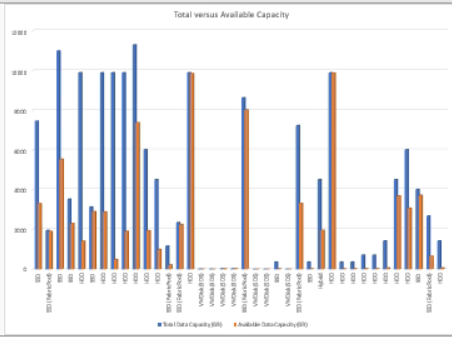

= Exibir gráficos de capacidade total agregada versus capacidade disponível no Active IQ Unified Manager
:allow-uri-read: 
:icons: font
:imagesdir: ../media/

[role="lead"]
Você pode criar um relatório para analisar a capacidade total de storage e a capacidade comprometida em um formato de gráfico do Excel.

.Antes de começar
* Você precisa ter a função de Application Administrator ou Storage Administrator.

Siga as etapas a seguir para abrir uma visualização Health: All Aggregates, baixar a visualização no Excel, criar um gráfico de capacidade total e comprometida, carregar o arquivo personalizado do Excel e agendar o relatório final.

.Passos
. No painel de navegação esquerdo, clique em *Armazenamento* > *Agregados*.
. Selecione *Reports* > *Download Excel*.
+
image::../media/download_excel_menu.png[Uma captura de tela da UI que mostra como baixar excel de relatórios.]

+
Dependendo do seu navegador, talvez seja necessário clicar em *OK* para salvar o arquivo.

. No Excel, abra o arquivo baixado.
. Se necessário, clique em *Enable Editing*.
. Na datasheet, clique com o botão direito do mouse na coluna Type e selecione *Sort* > *Sort A to Z*.
+
image::../media/sort_01.png[Uma captura de tela da interface do usuário que mostra como selecionar a classificação na coluna tipo.]

+
Isso organizará seus dados por tipo de armazenamento, como:

+
** HDD
** Híbrido
** SSD
** SSD (FabricPool)

. Selecione as colunas  `Type, Total Data Capacity,` e  `Available Data Capacity`.
. No menu *Inserir*, selecione um `3-D column` gráfico.
+
O gráfico aparece na datasheet.

+
image::../media/3d_column_01.png[Uma captura de tela que mostra o gráfico de colunas 3D.]

. Clique com o botão direito do mouse no gráfico e selecione *Mover gráfico*.
. Selecione *Nova planilha* e dê à planilha o nome de *Gráficos de armazenamento total*.
+
[NOTE]
====
Certifique-se de que a nova planilha apareça após as planilhas de informações e dados.

====
. Dê ao gráfico o título *Capacidade Total versus Capacidade Disponível*.
. Utilizando os menus *Design* e *Format*, disponíveis quando o gráfico está selecionado, você pode personalizar a aparência do gráfico.
. Quando estiver satisfeito, salve o arquivo com suas alterações. Não altere o nome ou a localização do arquivo.
+

. No Unified Manager, selecione *Reports* > *Upload Excel*.
+
[NOTE]
====
Certifique-se de estar na mesma visualização em que você baixou o arquivo do Excel.

====
. Selecione o arquivo Excel que você modificou.
. Clique em *Abrir*.
. Clique em *Enviar*.
+
Uma marca de seleção aparece ao lado do item de menu *Reports* > *Upload Excel*.

+
image::../media/upload_excel.png[Uma captura de tela da UI que mostra como carregar excel para relatórios.]

. Clique em *Relatórios Agendados*.
. Clique em *Add Schedule* para adicionar uma nova linha à página *Report Schedules*, para que você possa definir as características do agendamento para o novo relatório.
+
[NOTE]
====
Selecione o formato *XLSX* para o relatório.

====
. Insira um nome para o cronograma do relatório e preencha os outros campos do relatório, depois clique na marca de seleção (image:../media/blue_check.gif[""]) no final da linha.
+
O relatório é enviado imediatamente como teste. Depois disso, o relatório é gerado e enviado por e-mail aos destinatários listados na frequência especificada.

Com base nos resultados apresentados no relatório, talvez seja interessante equilibrar a carga nos seus agregados.
