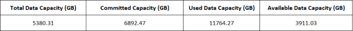

= Crie um relatório para exibir uma tabela e um gráfico de capacidade agregada no Active IQ Unified Manager
:allow-uri-read: 
:icons: font
:imagesdir: ../media/

[role="lead"]
Você pode criar um relatório para analisar a capacidade em um arquivo do Excel usando totais somados e o formato de gráfico de colunas agrupadas.

.Antes de começar
* Você precisa ter a função de Application Administrator ou Storage Administrator.

Siga as etapas a seguir para abrir uma visualização de Saúde: todos os agregados, baixar a visualização em Excel, criar um gráfico de capacidade disponível, carregar o arquivo Excel personalizado e agendar o relatório final.

.Passos
. No painel de navegação esquerdo, clique em *Armazenamento* > *Agregados*.
. Selecione *Reports* > *Download Excel*.
+
image::../media/download_excel_menu.png[Uma captura de tela da UI que mostra como baixar excel de relatórios.]

+
Dependendo do seu navegador, talvez seja necessário clicar em *OK* para salvar o arquivo.

. Se necessário, clique em *Enable Editing*.
. No Excel, abra o arquivo baixado.
. Crie uma nova planilha (image:../media/excel_new_sheet_icon.png[""]) após a `data` planilha e nomeie-a como *Capacidade Total de Dados*.
. Adicione as seguintes colunas na nova planilha Total Data Capacity:
+
.. Capacidade total de dados (GB)
.. Capacidade comprometida (GB)
.. Capacidade de dados utilizada (GB)
.. Capacidade de dados disponível (GB)

. Na primeira linha de cada coluna, insira a seguinte fórmula, certificando-se de que ela faça referência à datasheet (data!) e aos especificadores corretos de coluna e linha para os dados capturados (a capacidade total de dados extrai dados da coluna E, das linhas 2 a 20).
+
.. =SOMA(data!E$2:data!E$20)
.. =SUM(data!F$2:data!F$50)
.. =SOMA(data!G$2:data!G$50)
.. =SOMA(data!H$2:data!H$50)

+
A fórmula totaliza cada coluna com base nos dados atuais.

. Na datasheet, selecione as colunas *Capacidade total de dados (GB)* e *Capacidade comprometida (GB)*.
. Selecione *Gráficos Recomendados* no menu *Inserir* e selecione o gráfico de *Colunas Agrupadas*.
. Clique com o botão direito do mouse no gráfico e selecione *Mover gráfico* para movê-lo para a `Total Data Capacity` planilha.
. Usando os menus *Design* e *Format*, que estão disponíveis quando o gráfico está selecionado, você pode personalizar a aparência do gráfico.
. Quando estiver satisfeito, salve o arquivo com suas alterações. Não altere o nome ou a localização do arquivo.
+
image::../media/cluster_column_chart_2.png[Uma captura de tela da UI de um gráfico que mostra o total de dados e a capacidade comprometida.]

. No Unified Manager, selecione *Reports* > *Upload Excel*.
+
[NOTE]
====
Certifique-se de estar na mesma visualização em que você baixou o arquivo do Excel.

====
. Selecione o arquivo Excel que você modificou.
. Clique em *Abrir*.
. Clique em *Enviar*.
+
Uma marca de seleção aparece ao lado do item de menu *Reports* > *Upload Excel*.

+
image::../media/upload_excel.png[Uma captura de tela da UI que mostra como carregar excel para relatórios.]

. Clique em *Relatórios Agendados*.
. Clique em *Adicionar Cronograma* para adicionar uma nova linha à página Cronogramas de Relatório, para que você possa definir as características do agendamento do novo relatório.
+
[NOTE]
====
Selecione o formato *XLSX* para o relatório.

====
. Insira um nome para o cronograma do relatório e preencha os outros campos do relatório, depois clique na marca de seleção (image:../media/blue_check.gif[""]) no final da linha.
+
O relatório é enviado imediatamente como teste. Depois disso, o relatório é gerado e enviado por e-mail aos destinatários listados na frequência especificada.

Com base nos resultados mostrados no relatório, talvez você queira investigar a melhor forma de usar a capacidade disponível em toda a sua rede.
