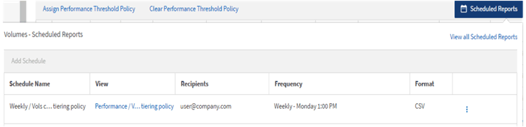

= Comece a gerar relatórios no Active IQ Unified Manager
:allow-uri-read: 
:icons: font
:imagesdir: ../media/

[role="lead"]
Crie um relatório personalizado de exemplo para experimentar a exploração de visualizações e o agendamento de relatórios. Este relatório de início rápido encontra uma lista de volumes que você pode querer mover para a camada da nuvem, pois há uma quantidade considerável de dados inativos (frios). Você abrirá a visualização Desempenho: todos os volumes, personalizará a visualização usando filtros e colunas, salvará a visualização personalizada como um relatório e agendará o relatório para compartilhá-lo uma vez por semana.

.Antes de começar
* Você precisa ter a função de Application Administrator ou Storage Administrator.
* Você precisa ter configurado os agregados do FabricPool e ter volumes nesses agregados.

Siga os passos abaixo para:

* Abra a visualização padrão
* Personalize as colunas filtrando e classificando os dados
* Salvar a visualização
* Agende a geração de um relatório para a visualização personalizada

.Passos
. No painel de navegação à esquerda, clique em *Armazenamento* > *Volumes*.
. No menu Exibir, selecione *Desempenho* > *Todos os volumes*.
. Clique em *Mostrar/Ocultar* para garantir que a coluna "`Disk Types`" apareça na visualização.
+
image::../media/show_hide_3.png[Uma captura de tela que mostra a lista suspensa do menu Mostrar/Ocultar.]

+
Adicione ou remova outras colunas para criar uma visualização que contenha os campos importantes para o seu relatório.

. Arraste a coluna "`Tipos de disco`" para junto da coluna "`Recomendação de nuvem`".
. Clique no ícone de filtro para adicionar os três filtros a seguir e, em seguida, clique em *Apply Filter*:
+
** Tipos de disco contém o FabricPool
** A recomendação de nuvem contém nível
** Dados frios maiores que 10 GB image:../media/filter_cold_data_2.png["Uma captura de tela da interface do usuário que mostra como aplicar um filtro a partir da opção de filtro."]

+
Observe que cada filtro é combinado com um operador lógico AND, de forma que todos os volumes retornados devem atender a todos os critérios. Você pode adicionar no máximo cinco filtros.

. Clique na parte superior da coluna "Dados Frios" para classificar os resultados de forma que os volumes com mais dados frios apareçam no topo da visualização.
. Quando a visualização é personalizada, o nome da visualização é "Visualização não salva". Dê à visualização um nome que reflita o que ela está mostrando, por exemplo "`Vols change tiering policy`". Quando terminar, clique na marca de seleção ou pressione *Enter* para salvar a visualização com o novo nome.
+
image::../media/report_vol_code_data_2.png[Uma captura de tela da UI que mostra a página de política de alteração de tiering do Vols com as colunas necessárias na ordem correta.]

. Baixe o relatório como um arquivo *CSV*, *Excel* ou *PDF* para visualizar o resultado antes de agendá-lo ou compartilhá-lo.
+
Abra o arquivo com um aplicativo instalado, como o Microsoft Excel (CSV ou Excel) ou o Adobe Acrobat (PDF), ou salve o arquivo.

+
[NOTE]
====
Você pode personalizar ainda mais seu relatório usando filtros complexos, ordenações, tabelas dinâmicas ou gráficos, baixando a visualização como um arquivo do Excel. Depois de abrir o arquivo no Excel, use os recursos avançados para personalizar seu relatório. Quando estiver satisfeito, faça upload do arquivo do Excel. Esse arquivo, com suas personalizações, é aplicado à visualização quando o relatório é executado.

====
+
Para obter mais informações sobre como personalizar relatórios usando o Excel, consulte _Exemplos de relatórios do Microsoft Excel_.

. Clique no botão *Relatórios Agendados* na página de inventário. Todos os relatórios agendados relacionados ao objeto, neste caso volumes, aparecerão na lista.
+

. Clique em *Adicionar agendamento* para adicionar uma nova linha à página Agendamentos de relatório, para que você possa definir as características do agendamento do novo relatório.
. Insira um nome para o relatório e preencha os outros campos do relatório, depois clique na marca de seleção (image:../media/blue_check.gif[""]) no final da linha.
+
O relatório é enviado imediatamente como teste. Depois disso, o relatório é gerado e enviado por e-mail aos destinatários listados na frequência especificada.

+
O relatório de exemplo a seguir está em formato CSV:

+
image::../media/csv_sample_report.gif[Uma captura de tela que mostra um relatório de exemplo em formato CSV.]

+
O relatório de exemplo a seguir está em formato PDF:

+
image::../media/pdf_sample_report.gif[Uma captura de tela que mostra um relatório de exemplo em formato PDF.]

Com base nos resultados apresentados no relatório, você pode usar o ONTAP System Manager ou a ONTAP CLI para alterar a política de armazenamento em camadas para "`auto`" ou "`all`" em determinados volumes, a fim de descarregar mais dados inativos para a camada de nuvem.
